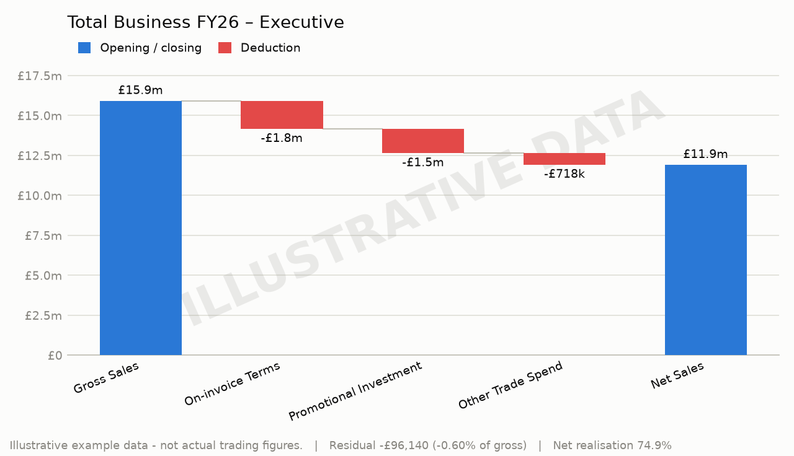
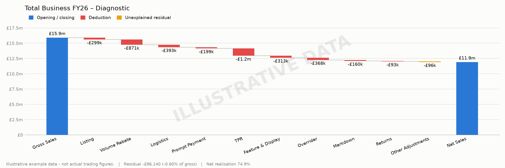
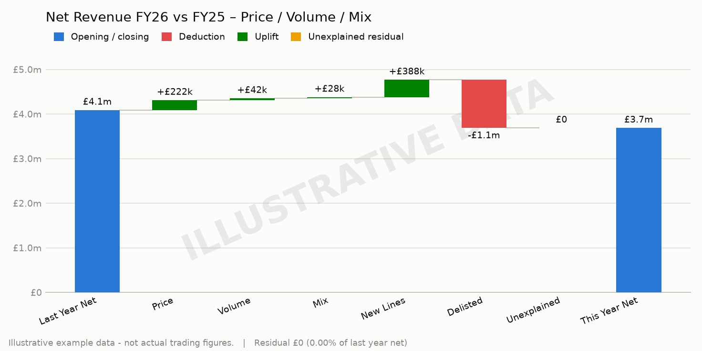

# Commercial Bridges: Gross-to-Net and Price/Volume/Mix

Two Python modules for building the bridges commercial finance runs on — and building
them so they reconcile by construction rather than by hope.

- **`g2n.py`** — gross sales to net sales, through trade terms and promotional
  investment. Where the money went *within* a period.
- **`pvm.py`** — last year's net to this year's net, split into price, volume and mix.
  *Why* it moved between periods.

Both are the same engine: an atomic step ledger, typed movements, a derived residual, and
audience-specific layouts that are all checked to close on the same number.

The core has **no third-party dependencies**. Charting is optional (matplotlib).

> ### ⚠️ All figures in this repository are illustrative and invented
> They are not any real company's trading. They are shaped to exercise the mechanics —
> deliberately *not* tidy — and every chart is stamped as example data. This is a tool,
> not a case study.



---

## The four ideas

**1. Movements and running positions are different types.**

A bridge mixes deductions (which belong in the walk) with subtotals like *Invoiced Sales*
(which do not). Adding a subtotal to the walk silently double counts everything above it —
the single most common bridge bug, and an invisible one, because the chart still looks
fine. Here the distinction is a type, the summation only touches movements, and a layout
that includes a position raises rather than renders.

**2. The residual is a first-class number.**

Source data never carries every pricing effect. The gap between the deductions you can
explain and the net you actually settled at is the residual. A bridge that absorbs it into
the nearest bar is lying about its own accuracy. Here the residual is derived rather than
supplied, is always a named step, and is reported as a share of gross — the bridge's own
error rate. A residual over a couple of percent means the deduction taxonomy is
incomplete, and no amount of chart polish makes the walk trustworthy until that is
understood.

**3. One ledger, several audiences.**

An exec wants five bars. A customer conversation wants trade-terms wording. An analyst
wants every atomic movement. Rebuilding the bridge per audience is how the three versions
drift apart and someone presents a net that nobody else recognises. Here layouts are views
over a single ledger, and every layout is checked to consume every movement and close on
the same net.

A layout may combine steps into one bar for presentation — but a step named in
`always_disclose` must still be published as a standalone figure. Combining bars is a
presentation choice; it must never be a way to make an uncomfortable number invisible.

**4. Spend that had to be earned is not the same as spend that was given away.**

Every deduction is typed `conditional` or not. Conditional spend requires the customer to
do something — hit a volume tier, run the promotion, execute the display, pay to terms.
Unconditional spend goes out regardless. The split is the first question worth asking of
any trade-terms structure, because unconditional money buys no behaviour, gets priced into
the customer's expectations, and is the hardest to ever win back.

Where a conditional term has an agreed maximum, supplying it as an *entitlement* turns the
term into a measurable one. Entitlements on unconditional steps are refused outright —
attainment against money nobody had to earn is meaningless.

---

## Gross to net

```
Total Business FY26 - Executive
--------------------------------------------------------------------
= Gross Sales                    £15.9m
  On-invoice Terms               -£1.8m
                                 £14.2m  (running)
  Promotional Investment         -£1.5m
                                 £12.6m  (running)
  Other Trade Spend              -£718k
                                 £11.9m  (running)
= Net Sales                      £11.9m
--------------------------------------------------------------------
  Net realisation                74.9%
  Residual as % of gross        -0.60%
! Other Adjustments (disclosed)     -£96,140
```

Figures display compact, but the disclosed residual stays exact — a rounded residual is
the thing this whole structure exists to prevent.

The same ledger under the diagnostic layout, with the residual in its own colour. It
closes on the same £11.9m as the executive view. That is enforced, not coincidence: a
layout that drops a movement raises rather than rendering a flattering net.



### Conditionality and attainment

```
Total Business FY26 - Trade Terms Quality
--------------------------------------------------------------------
  Conditional (earned)                -£3.0m
  Unconditional (given)               -£1.0m
  Unconditional share of spend         26.0%
--------------------------------------------------------------------
  Conditional term              Earned  Available  Attained  Retained
  Volume Rebate                 -£871k     -£1.0m     85.4%    -£149k
  Prompt Payment Discount       -£199k     -£199k    100.0%        £0
  Temporary Price Reduction     -£1.2m     -£1.3m     91.6%    -£111k
  Feature & Display             -£313k     -£390k     80.2%     -£77k
  Annual Overrider              -£368k     -£368k    100.0%        £0
--------------------------------------------------------------------
  Overall attainment                                  89.8%
```

Attainment below 100% is not automatically good news. It can mean the customer
under-delivered and the margin came back — or that the terms were never achievable and
the structure is driving no behaviour at all. The number starts the conversation; it does
not end it.

### Net realisation by customer

What the structure exists to produce — which accounts are actually paying for the
investment they receive:

```
  Customer                       Gross         Net  Realised   Resid
  National Multiple A             4.8m        3.1m     64.0%   -1.0%
  National Multiple B             3.6m        2.5m     69.4%   -0.6%
  Discounter C                    2.1m        1.7m     80.7%   -0.5%
  Own-label Contract D            5.3m        4.6m     86.2%   -0.3%
--------------------------------------------------------------------
  Total                          15.9m       11.9m     74.9%   -0.6%
```

---

## Price / volume / mix



```
Net Revenue FY26 vs FY25 - Year-on-Year Drivers
--------------------------------------------------------------------
  Last year net                    £4.1m
  This year net                    £3.7m
  Total growth                     -9.8%
--------------------------------------------------------------------
  Price growth                     £222k      5.4%
  Volume growth                     £42k      1.0%
  Mix effect                        £28k      0.7%
  New lines                        £388k      9.5%
  Delisted lines                  -£1.1m    -26.4%
```

**Price growth %** is the price effect over last year's net — the realised year-on-year
price movement, isolated from having sold more or having sold a richer blend. It is not
list price inflation and it is not the average shelf price moving by that much: it is what
actually landed in net revenue.

### The decomposition

For every product in both periods, with last-year `(p0, q0)` and this-year `(p1, q1)`:

```
Price  = Σ q1 × (p1 − p0)          charged more per unit
Volume = (Q1 − Q0) × P0bar         sold more units at last year's average price
Mix    = Σ q1 × p0 − Q1 × P0bar    sold a different blend of products
```

where `Q` is total units and `P0bar` is last year's volume-weighted average price. Lines
present in only one period have no prior price to measure against, so they are separated
into `New` and `Delisted` rather than distorting the other three.

These five are **exact** — they sum to the change in net revenue with no interaction term
and no plug. That property is tested against 500 randomised cases, not one worked example,
because a PVM bridge that needs a plug to close is one nobody should present.

Mix is the driver most often quietly dropped, and dropping it makes price look better or
worse than it really was.

---

## Usage

```python
from g2n import bridge_from_rows, fmcg_layouts

bridge = bridge_from_rows(rows, label="Total Business FY26", entitlements=entitlements)
layouts = fmcg_layouts()

print(bridge.to_text(layouts["executive"]))     # the walk
print(bridge.to_terms_text())                   # conditionality + attainment
bridge.to_chart(layouts["diagnostic"], "bridge.png", illustrative=True)

bridge.residual                 # the unexplained gap, in currency
bridge.residual_share()         # as a share of gross
bridge.unconditional_share()    # spend that bought no behaviour
bridge.overall_attainment()     # earned vs available, weighted
bridge.disclosures(layout)      # figures a combined bar must not hide
```

```python
from pvm import PeriodRow, pvm_bridge, pvm_layout, price_growth, growth_summary

movement = pvm_bridge(last_year_rows, this_year_rows)
print(growth_summary(movement))
price_growth(movement)          # realised YoY price growth %
```

Defining your own deduction taxonomy is a data change, not a code change:

```python
from g2n import Step, Kind

steps = (
    Step("GROSS",    "Gross Sales",    Kind.OPENING,  "Gross"),
    Step("REBATE",   "Volume Rebate",  Kind.MOVEMENT, "On-invoice", conditional=True),
    Step("INVOICED", "Invoiced Sales", Kind.POSITION, "Subtotal"),   # never summed
    Step("PROMO",    "Promotions",     Kind.MOVEMENT, "Off-invoice", conditional=True),
    Step("OTHER",    "Other",          Kind.MOVEMENT, "Off-invoice", is_residual=True),
    Step("NET",      "Net Sales",      Kind.CLOSING,  "Net"),
)
```

The bundled `FMCG_TRADE_TERMS` ledger is a conventional starting point, not a standard.
Currency defaults to GBP and is set per ledger.

---

## Running it

```bash
python demo.py                 # worked example: G2N, attainment, PVM
python demo.py --chart         # also writes stamped PNGs (pip install matplotlib)
python -m pytest -q            # 44 tests
```

The tests are not coverage tests. Each pins a specific way a bridge goes wrong in
practice: a subtotal added as a movement, a deduction dropped from one audience's view, a
residual quietly absorbed, a step counted twice, a proportional volume increase leaking
into mix, a reconciliation difference smeared across the drivers.

Chart colours are the reference data-viz palette, checked with the computable
accessibility gates (OKLCH lightness band, chroma floor, colourblind separation under
simulated protanopia and deuteranopia, contrast against the chart surface) rather than
chosen by eye. Red and green sit in the band that requires secondary encoding, so sign is
carried three ways beyond hue: deduction bars point down, uplift bars point up, and every
bar is direct-labelled with a signed value.

---

## Notes

Every figure here is invented. The demo data is deliberately untidy in two ways, because
real data is: the deductions do not fully explain the settled net, so the G2N bridge
carries a visible residual rather than a flattering zero; and the range changes between
years, so the PVM bridge has new and delisted lines to separate out before price and
volume mean anything.

Written by Stuart Douglas. Built from experience implementing pricing and gross-to-net
reporting in a manufacturing business; the modules are general-purpose and contain no
employer data, configuration or code.
